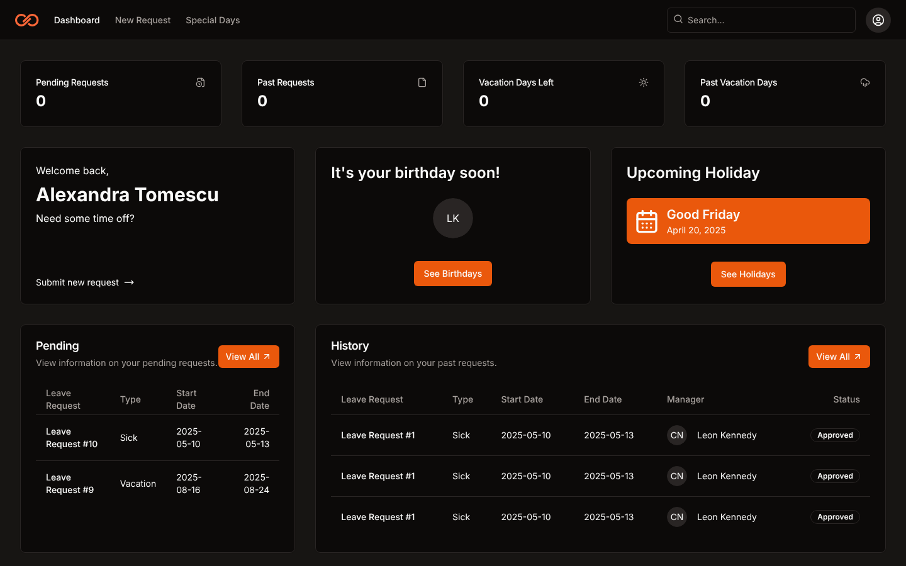
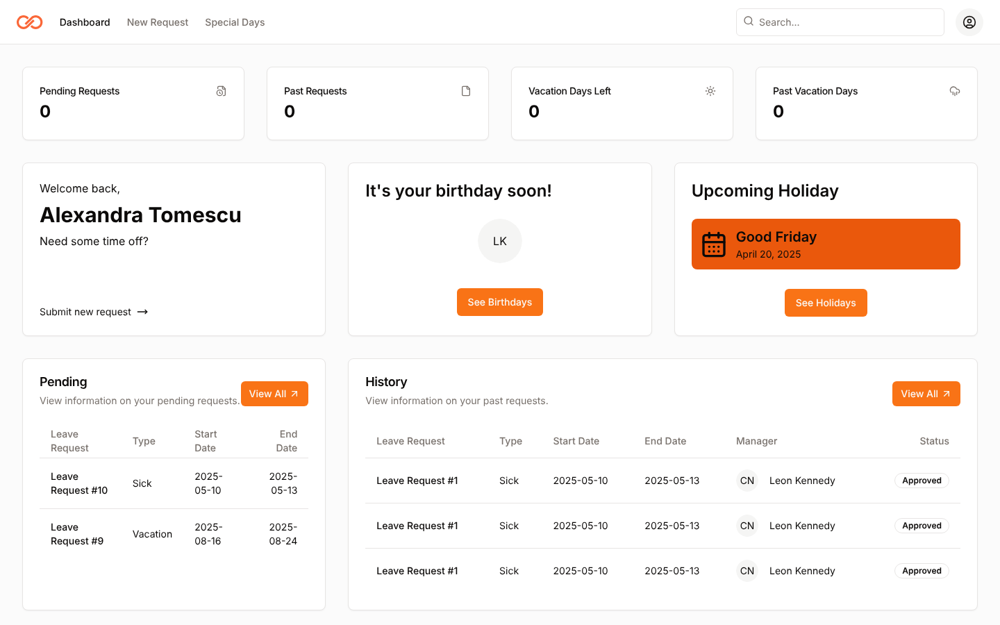
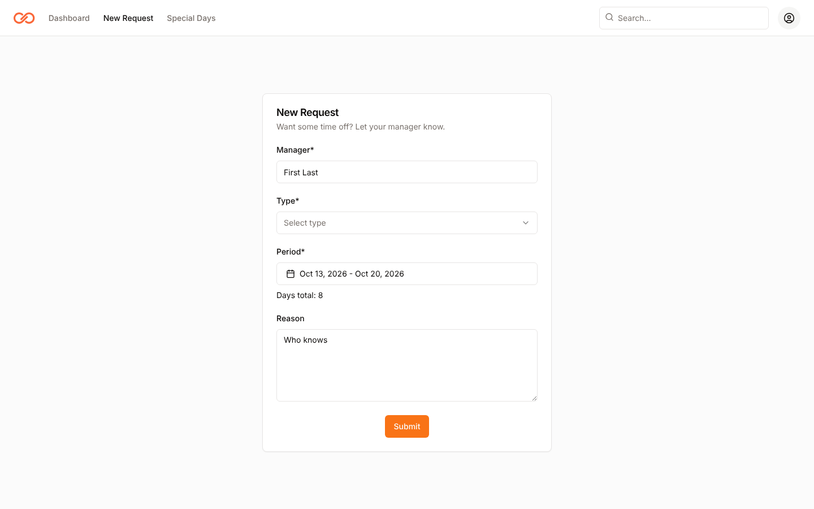
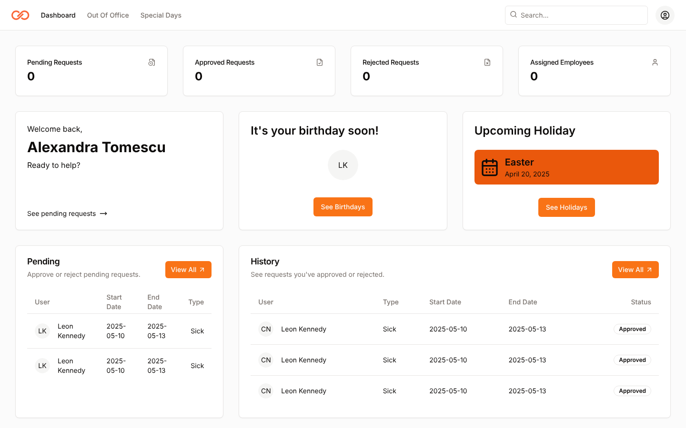
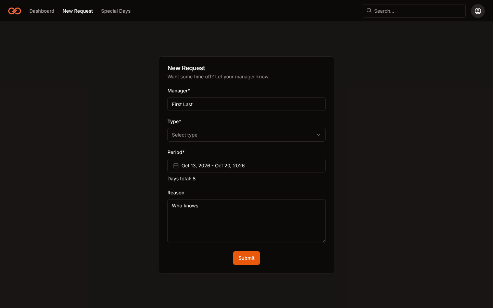
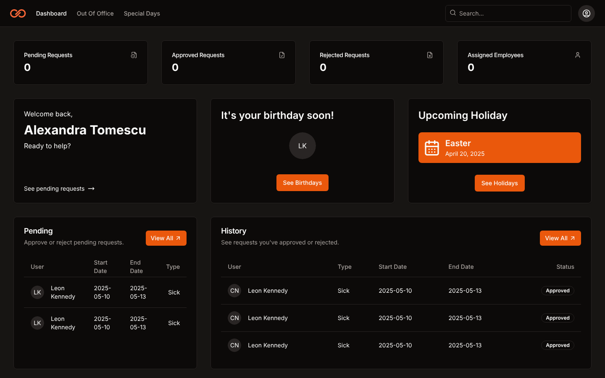

# Time Off

A leave request app with separate portals for employees and managers. Built during my practice internship at Crayon.

> **Status:** unfinished prototype. The interface is built (both portals), but there is no working backend yet: login just takes you to a portal, and the data you see is placeholder content. See [What's missing](#whats-missing).



## What it does

### Employee portal
- **Dashboard:** vacation day balance, upcoming holidays and birthdays, and pending and past requests at a glance
- **New request:** pick a category, a date range, and a reason
- **Pending and history:** separate views for requests waiting on approval and past ones
- **Special days:** upcoming holidays and birthdays
- **Settings:** profile and password

### Manager portal
- **Dashboard:** pending requests to approve or reject
- **Out of office:** who's away and when
- **Pending and history:** requests waiting on a decision and past ones
- **Special days and settings**

### General
- Sign up, email confirmation, and password reset screens
- Light and dark mode

## Screenshots

| Employee dashboard | New request | Manager dashboard |
| :---: | :---: | :---: |
|  |  |  |

Dark mode:

| Employee dashboard | New request | Manager dashboard |
| :---: | :---: | :---: |
|  |  |  |

*All data shown is placeholder content.*

## Built with

- **Frontend:** Svelte, Vite, Tailwind CSS, [shadcn-svelte](https://www.shadcn-svelte.com), svelte-spa-router
- **Backend (def):** Node.js, Express, MongoDB (Mongoose)

## Run it locally

You'll need [Node.js](https://nodejs.org) 18 or newer.

### Frontend

```bash
git clone https://github.com/mirelalexy/time-off.git
cd time-off/frontend
npm install
npm run dev
```

Open the address Vite prints. On the login screen, use **Log In As Employee** or **Log In As Manager** to explore each portal.

### Backend (optional)

The backend only connects to MongoDB and answers a test request on `/`. To run it, create `backend/.env`:

```
PORT=3000
MONGO_URI=your_mongodb_connection_string
```

```bash
cd backend
npm install
npm run start:dev
```

## What's missing

I built the interface first and ran out of time on the rest. The next steps would be:

- [ ] Data models for users, leave requests, and holidays
- [ ] Authentication (sign up, login, email confirmation, password reset)
- [ ] API endpoints to create, approve, and reject requests
- [ ] Connecting the frontend to the API (axios is already installed)
- [ ] Email notifications for requests and decisions

## About this project

My first practical project outside of university, built during an unpaid internship at Crayon that I did for my university's practice requirement. I had the freedom to choose what to build, so I designed and built the frontend myself, which is where I learned Svelte and shadcn-svelte and built a component-based UI (35+ components across two roles). I focused on the design and structure of the frontend and didn't get to the backend.
